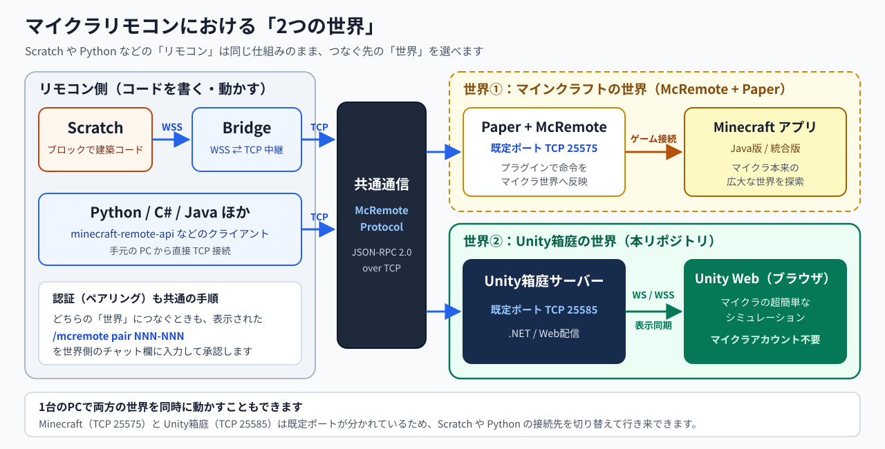
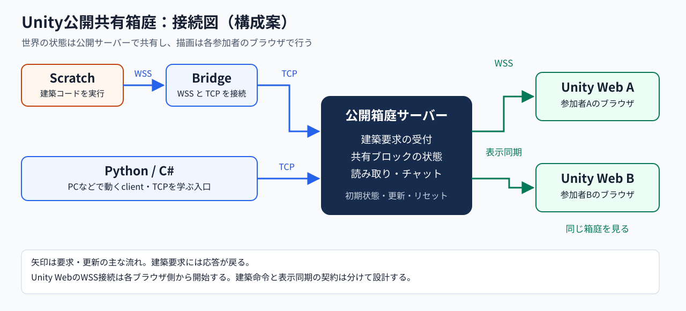

# mc-remote-unity-sandbox

[マイクラリモコン](https://mc-remote.com/)（Minecraft Remote / mc-remote）のための、ブラウザで開ける「Unity箱庭」サーバーとUnity Webクライアントです。マインクラフト本体を購入・導入しなくても、ScratchやPythonで書いたコードを同じリモコンの仕組みで動かして、3D空間の建築や探索を試せます。

🏠 **公式サイト**: [mc-remote.com](https://mc-remote.com/)

> [!NOTE]
> **🌐 言語方針について / Language Policy**\
> 本リポジトリは、一次情報（SSOT）の鮮度と正確性を保つため、日本語を正本として記述しています。多言語参加やIssue/PRの利用方針については [主要言語についての方針転換 / Language Policy](https://github.com/Naohiro2g/mc-remote-knowledge/blob/main/LANGUAGE_POLICY.md) をご覧ください。\
> *This repository is maintained in Japanese as its primary Single Source of Truth (SSOT). Multi-language contributions are welcome. Please see our [Language Policy](https://github.com/Naohiro2g/mc-remote-knowledge/blob/main/LANGUAGE_POLICY.md).*

---

## マイクラと並ぶ、もうひとつの「世界」

マイクラリモコンは、コーディング「で」世界を動かしながら「学び方を学ぶ」ためのオープンソースのツール群です。

[minecraft-remote-api](https://github.com/Naohiro2g/minecraft-remote-api)（Python）・[minecraft-remote-csharp](https://github.com/Naohiro2g/minecraft-remote-csharp)（C#）・[scratch-editor](https://github.com/Naohiro2g/scratch-editor)（Scratch）などが命令を送る **「リモコン」側** であるのに対し、本リポジトリは [McRemote](https://github.com/Naohiro2g/McRemote) を導入したマインクラフトサーバーと対等に並ぶ、 **命令を受け取って3D空間を動かす「世界」側** を担います。つまり、簡単に言うと、 **「Unity箱庭」は、マイクラを使わないマイクラリモコン** を可能にします。



どちらの「世界」に対しても、リモコン側のコードや `/mcremote pair NNN-NNN` によるペアリング手順は共通です。

| 比べるところ | マインクラフトの世界（[McRemote](https://github.com/Naohiro2g/McRemote) + Paper） | Unity箱庭の世界（本リポジトリ） |
| --- | --- | --- |
| 画面を見る環境 | Minecraft アプリ（Java版 / 統合版） | ブラウザで URL を開くだけ（Unity Web） |
| 世界のつくり | 広大なマイクラ本来のワールド | 9区画（400×400）・輪郭付きブロックで数えやすい共有空間 |
| 既定 TCP ポート | `25575` | `25585`（同じ PC で同時起動・切り替え可能） |
| 認証（ペアリング） | ゲーム内チャットで `/mcremote pair NNN-NNN` | Unity Web 左下のチャットで `/mcremote pair NNN-NNN` |

### Unity箱庭の接続と役割分担



Unity箱庭サーバー（.NET）がブロックの状態と認証・範囲検査をまとめて管理し、各参加者のブラウザ上で動く Unity Web がリアルタイムに3D表示を同期します。

---

## 手元のPCで動かしてみる（最短手順）

前提: [.NET 9 SDK](https://dotnet.microsoft.com/) がインストールされていること。Unity Web（`unity/Builds/WebGL`）の書き出しには Unity Editor **6000.6.8f1** を使います（手順は下の「開発・ビルドの構成」を参照）。

### Step 1: Unity箱庭サーバーを起動する

```bash
dotnet run --project server/src/Code2Create.UnitySandbox.Server -- \
  --url http://127.0.0.1:5080 \
  --web-root unity/Builds/WebGL \
  --tcp-host 127.0.0.1 \
  --tcp-port 25585
```

### Step 2: ブラウザで箱庭を開く

ブラウザで `http://127.0.0.1:5080/` を開きます。

- `WASD` / 矢印キーで移動、3D画面をクリックしてマウスで見回し（`Esc` で解放）
- `Space` 2回押しで飛行（`Shift` 2回押しで解除）、`Q` 2回押しで左上の座標HUD（`[脚]` / `[照準]`）を切り替え
- 右下の 3×3 ボタンで区画 `0..8` へワープできます

### Step 3: Python や Scratch から接続してペアリングする

[minecraft-remote-api](https://github.com/Naohiro2g/minecraft-remote-api) などの接続先ポートを `25585` に指定して実行します。

```python
from mc_remote import Minecraft

# Unity箱庭サーバー（既定ポート 25585）に接続
mc = Minecraft.create(address="localhost", port=25585)

# 区画8の原点 (100, 0, 100) に基準を合わせる
mc.setBuildOrigin(100, 0, 100)
mc.postToChat("Hello, Unity Sandbox!")
mc.setBlock(0, 63, 0, "gold_block")
```

ターミナルやScratchに表示される `/mcremote pair NNN-NNN` を、Unity Web 左下のチャット欄（`T` または `Enter` で開く）へ入力して送信すると認証が完了し、区画8の原点に金ブロックが現れます。

---

## 開発・ビルドの構成

| 置き場所 | 内容 |
| --- | --- |
| `server/` | 純粋 C# 世界モデル（`Code2Create.UnitySandbox.World`）、統合サーバー（`Code2Create.UnitySandbox.Server`）、テスト（`Code2Create.UnitySandbox.Tests`） |
| `unity/` | Unity Web クライアント用プロジェクト（Unity **6000.6.8f1**、Built-in Render Pipeline / Input Manager） |
| `scripts/` | Unity プロジェクト準備スクリプト（`prepare-project.sh`）とコンテナビルドスクリプト（`build-container.sh`） |
| `docs/` | ローカルデモ手順、表示同期仕様、観察メモ、設計メモ、図 |
| `Dockerfile` / `VERSION` | サーバーと WebGL 成果物をまとめるコンテナ定義とバージョン単一ソース |

### よく使うコマンド

- **サーバーテストの実行**:
  ```bash
  dotnet test server/Code2Create.UnitySandbox.sln
  ```
- **Unity プロジェクトの準備（Linux / macOS）**:
  ```bash
  bash scripts/prepare-project.sh /path/to/Unity/Editor/Unity
  ```
- **WebGL ビルドとコンテナイメージ生成**:
  ```bash
  ./scripts/build-container.sh
  ```
  WebGL ビルドを手元で行い、コンテナイメージのビルドだけ別ホストの Docker Engine へ委譲する場合は次のように実行します。
  ```bash
  DOCKER_HOST=ssh://<build-host> SKIP_WEBGL_BUILD=1 ./scripts/build-container.sh
  ```

---

## 関連ドキュメントと素材について

- [Unityのローカル建築デモ](docs/local-demo_ja.md)：Unity Editor での準備、操作一覧、検証方法。
- [表示同期とローカルWebビルド設計](docs/unity-sandbox-display-sync_ja.md)：`/ws/sync` の同期設計とテスト手順。
- [観察メモ](docs/observations_ja.md)：試用条件・結果・残る確認事項。
- [Unity公開共有箱庭の設計メモ](docs/unity-shared-sandbox-draft_ja.md) / [Unity内部の先行作業](docs/unity-internal-preparation_ja.md)：構想と段階整理。
- [ナレッジのUnityスポーク](https://github.com/Naohiro2g/mc-remote-knowledge/blob/main/19-unity/README_ja.md)：プロジェクト全体での位置づけと開発方針。

素材は自作の材質とコードで生成する境界線、および `SIL Open Font License 1.1` に基づく Noto Sans CJK JP サブセットフォント（`unity/Assets/LocalSandboxDemo/Resources/Fonts/`）を使用しています。Minecraft（Mojang）のテクスチャ・モデル・音声等の素材は同梱していません。
