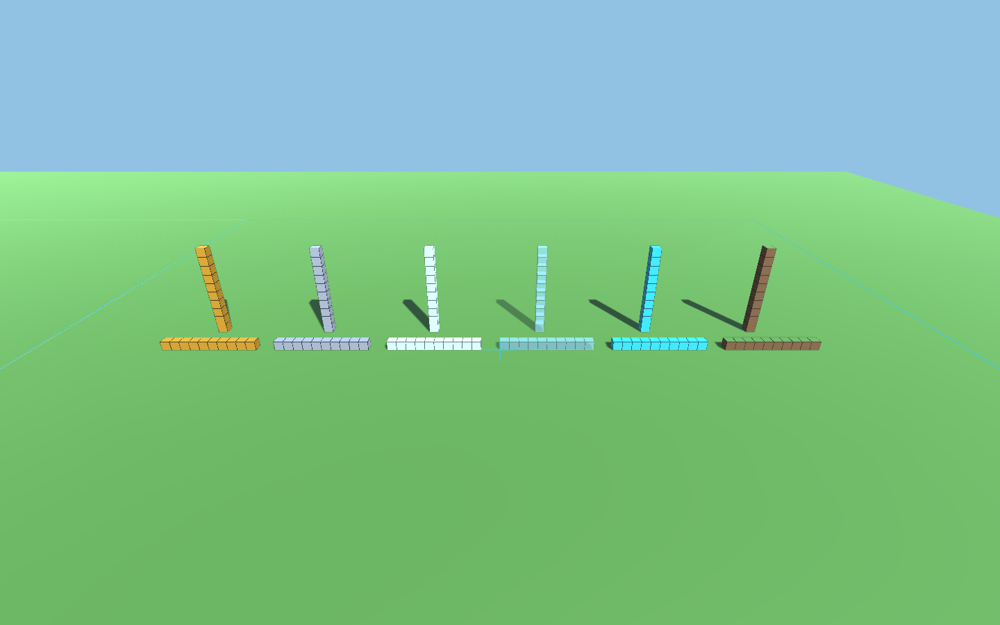

# Unityのローカル建築デモ

通信を使わずに、ブロックの見分けやすさ・数えやすさと、歩行・照準・座標表示を試すための試作です。
C# Client Libraryのrepoから履歴を引き継ぎ、このrepoの`unity/`で開発します。

この版はBRP（Built-in Render Pipeline、従来の描画方式）の比較用として残します。URP版は別のプロジェクトで用意し、同じ建築場面で見た目と負荷を比べる方針です。



左から金、鉄、シーランタン、ガラス、ダイヤモンド、草。Minecraftのテクスチャーは使用せず、Unityの材質とコードで生成した境界線を使っています。画像はUnityによる描画で、プレイ中の座標表示は含みません。

## 試す

Unity 6の**3D (Built-in Render Pipeline)**、従来の入力機能（Input Manager）を使います。移行後の確認環境は`6000.6.8f1`です。コンパイル・座標の検証・Play Modeの自動検証が通り、BRP版の試用も行っています。確認した内容は[観察メモ](observations_ja.md)を参照してください。URPなど別の描画方式への対応は後続で比べます。

### Unity Editorで準備する

1. このrepoをcloneします。
2. Unity Hubに`unity/`を追加し、指定された版のEditorで開きます。
3. `Assets/LocalSandboxDemo/Scenes/LocalSandboxDemo.unity`を開き、Playボタンを押します。

`Tools > Local Sandbox > Validate Demo`で、座標と配置の検証を実行できます。`Create Demo Scene`は別のデモシーンを追加したいときに使います。

入力が効かない場合は、`Edit > Project Settings > Player > Other Settings > Active Input Handling`を`Input Manager (Old)`または`Both`にし、求められたらEditorを再起動します。日本語表示には、`unity/Assets/LocalSandboxDemo/Resources/Fonts/NotoSansJP-Subset.ttf`（`SIL Open Font License 1.1`、詳細と出どころは[表示同期とローカルWebビルド設計](unity-sandbox-display-sync_ja.md)）を同梱しており、OSフォントが無いブラウザ環境でも表示できます。

### WebGLビルド（Unity Web）

`6000.6.8f1` を使い、次のコマンドで `unity/Builds/WebGL` へ書き出します（既定で圧縮なし・`runInBackground = true`）。

```sh
"$UNITY_EDITOR" -batchmode -nographics -buildTarget WebGL -projectPath "$DEMO_PROJECT" \
  -executeMethod Code2Create.UnitySandbox.LocalDemo.DemoEditor.BuildWebGL -quit -logFile /tmp/unity-webgl-build.log
```

書き出した成果物をローカルの `.NET` サーバー（[表示同期とローカルWebビルド設計](unity-sandbox-display-sync_ja.md)、既定 TCP ポート `25585` でローカル Minecraft 用 `25575` と並存可能）から配信すると、そのまま `/ws/sync` による表示同期とペアリング承認が使えます。

```sh
dotnet run --project server/src/Code2Create.UnitySandbox.Server -- --url http://127.0.0.1:5080 --web-root unity/Builds/WebGL
```

### Linux／macOSのターミナルで準備する

repoのrootで次のコマンドを実行します。通常のUnityライセンスと初回の環境準備が必要です。

```sh
bash scripts/prepare-project.sh /path/to/Unity/Editor/Unity
```

スクリプトは`unity/`を直接開き、コンパイルと座標・配置の検証を実行します。成功後、表示された場所をUnity Hubへ追加して開きます。
編集元は`unity/Assets/LocalSandboxDemo`です。再実行してもソースのコピーやシーンの再生成は行いません。ログは無視対象の`.local/logs/prepare.log`へ出力します。

## 操作と場面

| 操作 | 動き |
| --- | --- |
| 画面をクリック | 視線：クリック後マウス制御（チャット入力中や他ウィンドウからの復帰時も3D画面クリックで解除・再ロック） |
| Esc | 視線解除・脱出／チャット入力終了（WebGL の Pointer Lock 解除と同期） |
| WASD／矢印 | 歩く／飛ぶ（左上 `速度×1`/`速度×2` で歩行・飛行とも切替） |
| R | 開始位置・向きへ戻る |
| Space | ジャンプ（歩行時）／上昇（フライト時） |
| Left/Right Shift | 降下（フライト時） |
| Space × 2 | フライトモード開始 |
| Shift × 2 | フライトモード解除 |
| Q × 2 | 左上座標 HUD の対象切替（`[脚]` ⇔ `[照準]` / `[Legs]` ⇔ `[Target]`） |
| 1 | 各材質の10個の列・10段の柱へ切り替える（120個） |
| 2 | 各材質の5×3の壁・4段の階段へ切り替える（150個） |
| 3 | 基本10種ブロック見本へ切り替える（雪あり草・不安定TNT含む） |
| T / / / Enter | チャット・`/mcremote pair NNN-NNN`入力（`/` 開始時は先頭 `/` 入力済み、送信後もフォーカス維持、チャットパネル全域クリックでフォーカス） |
| 左上パネル | 大きめ太字等幅の座標行と `速度×1`/`速度×2`・`たたむ`/`ひらく` を常時表示。展開時は状態行・`再同期`・`全画面`・`EN`/`JA` 言語切替を表示（WebGL は `beforeunload` 確認ガード付き） |
| 右下パネル（区画0〜8・発光・案内） | 左下チャットと高さを揃え、各区画の相対 `(5, 96, -40)`（仮想原点 `(0, 96, 0)` 向き）への上空ワープ、`直前のブロックへ`、ピンク色 0.5 秒配置発光の `発光:ON`/`発光:OFF`、キー案内4行を表示 |

最初の場面は120個、壁と階段の場面は150個です。地面や区画のガイドはこの個数に含みません。
`Local Sandbox Demo`の`Column Height`をPlay前に変えると、柱の高さを変えて比べられます。

地面は400×400の全体構造（`y=59..-64` 石、`y=61..60` 土）の上で、区画0〜8（区画4を含む）それぞれの原点周囲 `-48..48` に `y=62` の草ブロックを敷き、区画間は `y=62` の草が剥がれて `y=61` の土が見える溝になっています。各区画原点には座標軸（`+X`/`+Z` は実線、`-X`/`-Z` および `Y=63..95` は点線）と、北向き・`y=100`・ドロップシャドウ付きの `区画N (x, y, z)` / `Plot N (x, y, z)` 3D ビルボードを表示しています。

ブロック群（`setBlocks` 等で1つの GameObject へまとめられた箱）は、面ごとのリピート UV タイルと各ブロック固有色の暗色（`0.62` 乗算）縁取りで描画しており、複数並んだ状態でも 1 ブロック単位を数え分けられます（草・土・石は縁取りなし）。

左上パネルでは、常時表示の McRemote 形式の等幅太字座標 HUD（`[脚/照準] 絶対座標 / 相対座標 / #方位#`、`[Legs/Target]` 日英切替可）と `速度×1/×2`・`たたむ/ひらく` を表示し、展開時に接続状態・ブロック数・歩行/フライト状態・`再同期`・`全画面`・`EN/JA` を表示します（Scratch と並べる幅 700px 前後にも対応）。表示原点の初期値は `(100, 0, 100)` で、Inspector の `Display Origin` またはペアリング後の `build.setOrigin` に追従します。照準が当たらないときは `[-]` と表示します。

## 変えて比べる

- `DemoPalette.cs`：材質の色・反射・発光・ガラスの透明度・境界線。
- `LocalSandboxDemo.cs`の`Populate`：柱・壁・階段の配置。普通のUnity内部の処理です。
- `LocalSandboxWalker.cs`：歩く速さ・視点の高さ・見回す感度。

数を数えるだけでなく、「この高さを変えたい」「この材質で別の形を作りたい」と思えたところを残します。
最初の観察は[観察メモ](observations_ja.md)へ記録します。

## 開発時の検証

`Tools > Local Sandbox > Validate Demo`は、編集中のシーンから独立したプレビューシーンを作って検証し、終わったら閉じます。
負の位置の切り下げ、相対座標、区画原点、地面と6面への照準、同じセルの置換・除去、場面の切り替えを確認します。失敗した場合はConsoleへ例外、成功した場合は`LOCAL_SANDBOX_VALIDATION_PASS`を出します。

同じ検証をコマンドから呼ぶ場合は、次の形です。`UNITY_EDITOR`と`DEMO_PROJECT`は、それぞれ手元の実行ファイルとこのrepoの`unity/`の絶対パスに置き換えてください。

```sh
"$UNITY_EDITOR" -batchmode -nographics -quit -projectPath "$DEMO_PROJECT" \
  -executeMethod Code2Create.UnitySandbox.LocalDemo.DemoEditor.Validate -logFile /tmp/local-sandbox-validation.log
```

Play Modeの初期化・重力・歩行・地面の当たり判定は、同じコマンドの`-executeMethod`を`Code2Create.UnitySandbox.LocalDemo.DemoPlaySmoke.Run`へ変え、`-quit`を外して検証できます。結果は`LOCAL_SANDBOX_PLAY_SMOKE_PASS`または`FAIL`で出力し、自動終了します。実行結果と確認が残っている点は[観察メモ](observations_ja.md)に記録します。

`DemoPlaySmoke.Run`は試験用シーンを追加します。普段編集するProjectを保つには、`unity/`のAssets・Packages・ProjectSettingsを別の検証用フォルダーへコピーし、そちらを`DEMO_PROJECT`に指定してください。LibraryやUserSettingsはコピーしません。

`DemoEditor.CapturePreview`は、`-nographics`を外して`-demoPreview /absolute/path.png`を渡すと、材質比較の画像を書き出します。画面を使える環境が必要です。

## 今回の範囲と次に確かめること

これは少数のGameObjectを使う描画の比較基準です。草の上面には薄い表示用の面を重ねています。実際の歩きやすさ、端末ごとの日本語表示、透明なブロックが重なったときの数えやすさは、触って調整します。反射の見え方も、照明や周囲の映り込みを含めて比較する余地があります。

Webへの書き出し・タッチ操作・性能比較、手作業による設置と破壊は後続です。ビルドへ進む際には、コードから探す`Standard`と`Sprites/Default`のshader（描画処理）が生成物に含まれることも確認します。

通信、認証、共有世界の同期、Minecraft RemoteのC# Client Libraryには依存しません。材質の分類やセルの保持は、この試作内のもので、正式なブロックIDや配信形式の決定ではありません。

根拠となる範囲は[Unity内部で先に進める作業](unity-internal-preparation_ja.md)と、knowledgeの[C#の現在地](https://github.com/Naohiro2g/mc-remote-knowledge/blob/49b93b1fb2fddc928de956ca2ffa9a7b462e19c8/18-csharp-client/README_ja.md)を参照してください。

実装時に参照したUnity公式資料：[照準のRaycast](https://docs.unity3d.com/6000.0/Documentation/ScriptReference/Physics.Raycast.html)、[CharacterControllerの移動](https://docs.unity3d.com/6000.0/Documentation/ScriptReference/CharacterController.Move.html)、[透明材質の設定](https://docs.unity3d.com/6000.0/Documentation/Manual/StandardShaderMaterialParameterRenderingMode.html)、[Editorのコマンドライン](https://docs.unity3d.com/6000.0/Documentation/Manual/EditorCommandLineArguments.html)。
