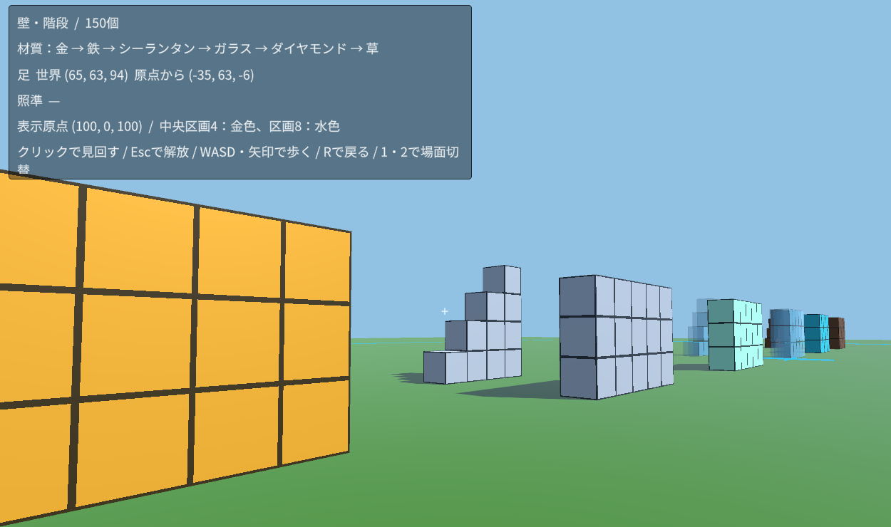

# ローカル建築デモの観察メモ

## 初回の自動検証と描画確認

- Unity：6000.6.7f1、Linux、Built-in Render Pipeline。材質比較の画像は6000.0.56f1で生成した。
- 場面：6材質、10個の列と10段の柱、120個。壁と階段へ切り替えた場合は150個。
- 自動検証：負の座標の切り下げ、相対座標、区画0/4/8の原点、地面の上面、足と地面の当たり判定、ブロックの6面に当たる照準、置換・除去、場面の初期化が成功。
- 描画：仮想画面上のOpenGL、llvmpipeによるソフトウェア描画。材質比較の画像を書き出して目視した。これは端末性能の測定ではない。
- 調整：発光が境界を隠していたため、境界線を発光にも反映し、発光の強さを下げた。草の上面と親の上面の重なりも調整した。
- 残る確認：人が歩いて数えた結果、操作感、プレイ中の座標表示の読みやすさ、ガラスが重なった場合、実機の負荷。Web／タブレットは未確認。
- Play Mode：6000.6.7f1では開始でき、初期化・足y=63・1単位の移動・地面との衝突・目の高さのチェックを通過した。ただし、Unity Editor内の`UnityEditor.Search.SearchDatabase.EnumerateAll`が`ArgumentOutOfRangeException`を出すため、ログのエラーも判定する自動検証の総合結果はFAIL。再実行でも同じ例外を観測した。試作の動作チェックと、Editorの環境エラーを分けて記録し、検証全体の成功とは扱わない。
- 起動環境：公式配布版Hubと新Editorへの切り替え後は、旧環境で観測したライセンスエラーによる停止は起きていない。ライセンス設定の変更は行っていない。

## 2026-10-27 BRP版の試用と自動試験の修正

- human ownerがBRP版を試用し、良好との反応。ライトが地面より下にある点の指摘を受け、生成位置を地上の`(100, 160, 100)`へ変更した。コードの回転は光が斜め下へ進む向きであることを確認し、維持した。
- Web版は未作成・未検証。
- Editor検索例外は、6000.6.7f1で新しく作ったプロジェクトでも元の自動試験で再現した。旧版からの更新だけに依存する現象ではなかった。
- 自動試験が起動直後の`executeMethod`から即座にPlayへ入り、検索索引の初期化と競合することが原因だった。Editorの起動処理後に入るよう`delayCall`でPlay開始を遅らせると、検索索引が作られ、`LOCAL_SANDBOX_PLAY_SMOKE_PASS`、終了コード0となった。エラーを無視する処理や、検索機能を無効にする設定は加えていない。
- 対照確認では、索引が未作成の同じ新規プロジェクトで、元の試験がFAIL、修正後がPASS。キャッシュ削除・Editor設定変更・Unityの再インストールはしていない。
- 以前に例外が出ていた6000.0から更新した検証プロジェクトでも、同じ修正でPASSした。

### 試用時のスクリーンショット

ユーザー提供のスクリーンショット。壁・階段の場面を歩いて見た状態で、ブロックの境界と足の座標表示を確認できる。

## 2026-11-11 repo移行後の再検証

- Unity：**6000.6.8f1 (237b6593792b)**、Linux、Built-in Render Pipeline、Input Manager。Unity公式APIで6.6の修正版を確認し、Editor配布物のbytesと公式integrityを照合した。
- `unity/`にAssets・Packages・ProjectSettingsとデモシーンを置いた。元の生成済みProjectを上書きせず、新しいProjectで確認した。
- 準備script：repoのrootで`bash scripts/prepare-project.sh "$UNITY_EDITOR"`を実行し、終了0。コンパイルと`LOCAL_SANDBOX_VALIDATION_PASS`を確認。
- `unit/deterministic`：負の座標、相対座標、区画原点、地面・足、6面の照準、置換・除去、120個／150個の場面切り替えをPASS。再現コードは`unity/Assets/LocalSandboxDemo/Editor/DemoEditor.cs`。
- Play Mode：Assets・Packages・ProjectSettingsをコピーした独立の検証Projectで、READMEの`DemoPlaySmoke.Run`を実行。終了0、`LOCAL_SANDBOX_PLAY_SMOKE_PASS`。初期化、足y=63、1単位の歩行、地面との衝突、目の高さをPASS。検索索引の例外も発生しなかった。再現コードは`DemoPlaySmoke.cs`。
- 描画：仮想画面、OpenGL、llvmpipe (LLVM 20.1.2)で`DemoEditor.CapturePreview`を実行し、終了0。1440×900の画像を目視し、6材質、10個の列／柱、地面・区画線が移行前の比較画像と同じ場面として描画されることを確認。画像の完全一致や実機性能の保証ではない。
- 既存Runtime／EditorのC#コードと旧画像はbytesを保持。試用中の旧`.local/UnityProject`は変更していない。
- 今回はagentによるローカル再検証で、人による新たな試用、Web build、URP、タブレット、通信／共有状態同期は未検証。

## 次の観察を記録する欄

- 日付・端末・OS・Unity／ブラウザの版：
- 場面・ブロック数・変えた設定：
- 試す前の予想：
- 見分けられた／数えられたもの：
- 迷ったところ・負荷を感じたところ：
- 変えてみたくなった形・表現：
- 次に一つ変えて比べること：
