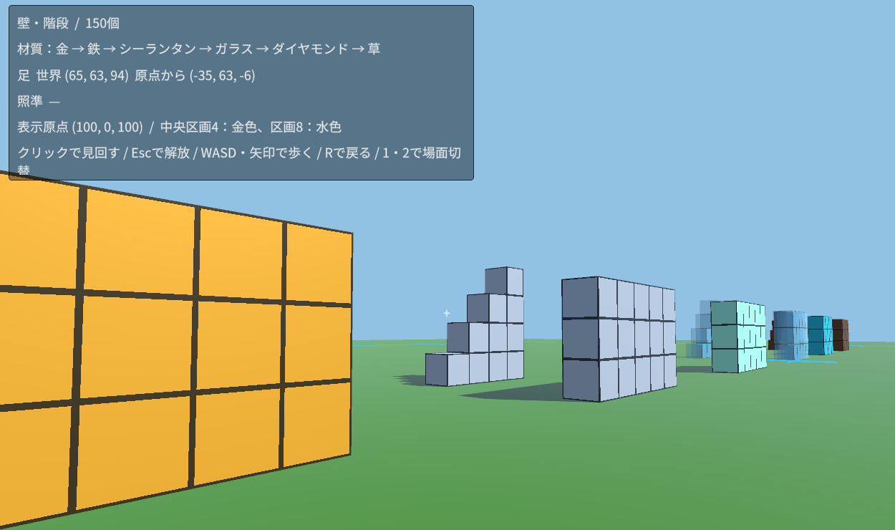

# ローカル建築デモの観察メモ

## 初回の自動検証と描画確認

- Unity：6000.6.7f1、Linux、Built-in Render Pipeline。材質比較の画像は6000.0.56f1で生成した。
- 場面：6材質、10個の列と10段の柱、120個。壁と階段へ切り替えた場合は150個。
- 自動検証：負の座標の切り下げ、相対座標、区画0/4/8の原点、地面の上面、足と地面の当たり判定、ブロックの6面に当たる照準、置換・除去、場面の初期化が成功。
- 描画：仮想画面上のOpenGL、llvmpipeによるソフトウェア描画。材質比較の画像を書き出して目視した。これは端末性能の測定ではない。
- 調整：発光が境界を隠していたため、境界線を発光にも反映し、発光の強さを下げた。草の上面と親の上面の重なりも調整した。
- 残る確認：人が歩いて数えた結果、操作感、プレイ中の座標表示の読みやすさ、ガラスが重なった場合、実機の負荷。Web／タブレットは未確認。
- Play Mode：6000.6.7f1では開始でき、初期化・足y=63・1単位の移動・地面との衝突・目の高さのチェックを通過した。ただし、Unity Editor内の`UnityEditor.Search.SearchDatabase.EnumerateAll`が`ArgumentOutOfRangeException`を出すため、ログのエラーも判定する自動検証の総合結果はFAIL。再実行でも同じ例外を観測した。試作の動作チェックと、Editorの環境エラーを分けて記録し、検証全体の成功とは扱わない。
- 起動環境：公式配布版Hubと新Editorへの切り替え後は、旧環境で観測したライセンスエラーによる停止は起きていない。ライセンス設定の変更は行っていない。

## 2026-10-27 BRP版の試用と自動試験の修正

- human ownerがBRP版を試用し、良好との反応。ライトが地面より下にある点の指摘を受け、生成位置を地上の`(100, 160, 100)`へ変更した。コードの回転は光が斜め下へ進む向きであることを確認し、維持した。
- Web版は未作成・未検証。
- Editor検索例外は、6000.6.7f1で新しく作ったプロジェクトでも元の自動試験で再現した。旧版からの更新だけに依存する現象ではなかった。
- 自動試験が起動直後の`executeMethod`から即座にPlayへ入り、検索索引の初期化と競合することが原因だった。Editorの起動処理後に入るよう`delayCall`でPlay開始を遅らせると、検索索引が作られ、`LOCAL_SANDBOX_PLAY_SMOKE_PASS`、終了コード0となった。エラーを無視する処理や、検索機能を無効にする設定は加えていない。
- 対照確認では、索引が未作成の同じ新規プロジェクトで、元の試験がFAIL、修正後がPASS。キャッシュ削除・Editor設定変更・Unityの再インストールはしていない。
- 以前に例外が出ていた6000.0から更新した検証プロジェクトでも、同じ修正でPASSした。

### 試用時のスクリーンショット

ユーザー提供のスクリーンショット。壁・階段の場面を歩いて見た状態で、ブロックの境界と足の座標表示を確認できる。

## 2026-11-11 repo移行後の再検証

- Unity：**6000.6.8f1 (237b6593792b)**、Linux、Built-in Render Pipeline、Input Manager。Unity公式APIで6.6の修正版を確認し、Editor配布物のbytesと公式integrityを照合した。
- `unity/`にAssets・Packages・ProjectSettingsとデモシーンを置いた。元の生成済みProjectを上書きせず、新しいProjectで確認した。
- 準備script：repoのrootで`bash scripts/prepare-project.sh "$UNITY_EDITOR"`を実行し、終了0。コンパイルと`LOCAL_SANDBOX_VALIDATION_PASS`を確認。
- `unit/deterministic`：負の座標、相対座標、区画原点、地面・足、6面の照準、置換・除去、120個／150個の場面切り替えをPASS。再現コードは`unity/Assets/LocalSandboxDemo/Editor/DemoEditor.cs`。
- Play Mode：Assets・Packages・ProjectSettingsをコピーした独立の検証Projectで、READMEの`DemoPlaySmoke.Run`を実行。終了0、`LOCAL_SANDBOX_PLAY_SMOKE_PASS`。初期化、足y=63、1単位の歩行、地面との衝突、目の高さをPASS。検索索引の例外も発生しなかった。再現コードは`DemoPlaySmoke.cs`。
- 描画：仮想画面、OpenGL、llvmpipe (LLVM 20.1.2)で`DemoEditor.CapturePreview`を実行し、終了0。1440×900の画像を目視し、6材質、10個の列／柱、地面・区画線が移行前の比較画像と同じ場面として描画されることを確認。画像の完全一致や実機性能の保証ではない。
- 既存Runtime／EditorのC#コードと旧画像はbytesを保持。試用中の旧`.local/UnityProject`は変更していない。
- 今回はagentによるローカル再検証で、人による新たな試用、Web build、URP、タブレット、通信／共有状態同期は未検証。

## 次の観察を記録する欄

## 2026-11-14 順番 1〜3（世界のモデル・ローカル WebGL・表示同期サーバー）の検証

- ナレッジ参照コミット：`451988d9cf55cfa0f13f4a1b00dc1983274b719d`（`2026-11-14-01`, `2026-11-14-02` 反映）
- Unity：**6000.6.8f1 (237b6593792b)**、Linux、Built-in Render Pipeline、Input Manager、WebGL
- .NET テスト：`dotnet test server/Code2Create.UnitySandbox.sln` で全 **14/14** ケース通過（初期地形 `y=62`草・`61..60`土・`59..-64`石＋`x0`層イースターエッグ、基本10ブロックと拡張性、`world.setBlock`/`world.getBlock`/`world.setBlocks`/`chat.post`、高さ・水平両方の世界外 `out_of_bounds` と `setBlocks` の原子性、`32,768` 体積上限 `work_limit_exceeded`、WebSocket `/ws/sync` 接続・`/mcremote pair NNN-NNN` 承認・世界リセット時の紐付け維持・ペアリング試行レート制限・`viewerId` 非露出）。
- Unity 検証（WebGL 用修正後）：`DemoEditor.Validate`（`LOCAL_SANDBOX_VALIDATION_PASS`、土の掘り起こし追加確認含む）および `DemoPlaySmoke.Run`（`LOCAL_SANDBOX_PLAY_SMOKE_PASS`）ともに終了 0。
- WebGL ビルド・ブラウザ検証：`DemoEditor.BuildWebGL` により `unity/Builds/WebGL`（`26,387,289` bytes、圧縮なし）を生成し、`Code2Create.UnitySandbox.Server` の静的配信＋`/ws/sync` と headless Chrome（SwiftShader WebGL 2.0）で検証（`Errors count: 0`、`connections: 1`）。
  - 途中のブラウザ検証で WebGL の IL2CPP ストリッピングにより `BoxCollider` が欠落し床をすり抜ける問題と、`index.html` の固定キャンバスによる横並び狭幅表示（`640x800`）での見切れを検出・修正（`link.xml`・`BoxCollider` 明示参照・レスポンシブ CSS 埋め込み）。修正後の再検証で `1280x720`・`640x800` とも日本語 UI（`NotoSansJP-Subset.ttf`、`SIL Open Font License 1.1`、`4,947,692` bytes）、区画8の3Dラベル、スナップショット受信表示（`[同期] スナップショットを受信しました (地域 0件)`）を確認。
- 残る確認：実際の人間による操作感・Scratch LAN パッケージおよび順番 4（TCP JSON-RPC 口）と組み合わせた一気通貫のブロック配置確認。

## 2026-11-14 順番 4（TCP JSON-RPC 2.0 受付・pairing・12 メソッド実装）の検証

- ナレッジ参照コミット：`451988d9cf55cfa0f13f4a1b00dc1983274b719d`（`2026-11-14-01`, `2026-11-14-02`, `10-protocol/wire-format-design_ja.md`, `10-protocol/versioning-design_ja.md`, `minecraft-remote-tooling` F1/events fixture 照合）
- .NET テスト：`dotnet test server/Code2Create.UnitySandbox.sln --no-restore` で全 **18/18** ケース通過（0 警告、0 エラー、所要 4.00 秒）。
  - pre-hello ゲート（`expected_hello` 応答と TCP 切断）、`hello` の semver 互換検証（`protocol_required` / `protocol_mismatch`）および token エラー（`auth_required` / `token_not_found` / `token_invalid` / `token_expired`）と `unknown_dimension` 拒否
  - Bridge 相当の別 TCP 接続を跨ぐ `auth.pairBegin` → pending `auth.pairPoll` → Unity Web `/ws/sync` での `/mcremote pair NNN-NNN` 承認 → `auth.pairPoll` token 取得と再利用防止（`pair_not_found`）→ token 付き `hello`（既定原点 `[0, 0, 0]`, `mc_version: "1.21.11"`, `server: "unity-sandbox"`, `world_constants: { "y_sea": 62 }`, `viewerId` とは別の UUID `player`）
  - `catalog.get`（10 ブロック＋SHA-256 `catalogHash` 一致）、`events.poll`（空応答と不正パラメータ拒否）、`build.setOrigin` / `build.setDimension`（`/ws/sync` `streamUpdated` 同期）、FAST notification での `world.setBlock` / `world.setBlocks` ＋ `connection.flush` バリア（`blockDelta` ライブ配信と `out_of_bounds` 拒否）、`chat.post`（`chat` ライブ配信）、未対応メソッドの `method_not_found`、および `world.Reset()` 後の token／画面紐付け維持を確認。
- 確認した補足事項：
  - `Naohiro2g/McRemote`（`main`）の `RemoteSession.java` を確認したところ、現時点では `hello` 応答に `"server"` キーを入れていなかったため、`wire-format-design_ja.md` §6.2 および F1 fixture（`"server": "fixture-server"`）に揃えて文字列 `"unity-sandbox"` を返す形に実装した（McRemote 側の形式が確定・変更された場合は追従可能）。
- 残る確認：Scratch LAN パッケージおよび実 Bridge プロセスを接続しての対話・GUI 疎通試験。

## 2026-11-14 一気通貫結合確認（Scratch 相当 WS → 実 `@mc-remote/bridge` → TCP JSON-RPC → Display Sync → Headless Chrome Unity WebGL）

- ナレッジ参照コミット：`451988d9cf55cfa0f13f4a1b00dc1983274b719d`
- 結合コンポーネント：
  - `Naohiro2g/minecraft-remote-tooling`（commit `6447f6e8cbfbeeb9d229990b5c4f6e82a5875666`、`/tmp/` 上の一時 read-only clone で `@mc-remote/bridge@0.1.0` をビルド・起動）
  - `Code2Create.UnitySandbox.Server`（HTTP/WebSocket `:18080` + WebGL 静的配信 + TCP JSON-RPC `:25575`）
  - Unity **6000.6.8f1 (237b6593792b)** WebGL ビルド＋Headless Chrome（SwiftShader WebGL 2.0、`1280x720`）
- 確認できた導線：
  1. `.NET` テスト 18/18 通過後、WebGL ビルドおよび実 `@mc-remote/bridge`（`Origin: https://scratch.mc-remote.com`、`Sec-WebSocket-Protocol: mcremote.bridge.one-shot.v1`、`?sandbox=127.0.0.1`）経由の接続を確立。
  2. Unity WebGL がブラウザ起動直後に `/ws/sync?viewerId=v_...` へ接続し、初期スナップショット（`worldEpoch: 1, seq: 0, regions: []`）と区画 8 の初期視界を描画。
  3. Bridge 経由の未認証 `hello` が `auth_required` (`-32000`) を返し、`mcremote_bridge_transport: "one-shot-v1"` 封筒で `auth.pairBegin`（6 桁 `pair_code` 発行）および `auth.pairPoll`（`pending`）が別 TCP 接続を跨いで動作。
  4. Unity WebGL ページの生 `/ws/sync` ソケット経由で `/mcremote pair NNN-NNN` を承認し、`pairResult`（`approved: true`, `streamId: "stream-1"`）受信後に `auth.pairPoll` から bearer token (`mcrs_...`) を取得。
  5. 新規 Bridge WS セッションで token 付き `hello`（`protocol: "23.2.1"`, `mc_version: "1.21.11"`, `server: "unity-sandbox"`, `world_constants.y_sea: 62`, `origin: [0, 0, 0]`）・`catalog.get`（10 ブロックと SHA-256 `catalogHash` 一致）・`events.poll`・`build.setDimension`・`build.setOrigin`（`[100, 0, 100]`）・`world.setBlocks`＋notification `world.setBlock`＋`connection.flush`・`world.getBlock`（通常および `[0, 320, 0]` の `out_of_bounds` `-32000`）・`chat.post` が透過通過。
  6. Unity WebGL 側で `streamUpdated`（4 件）・`blockDelta`（8 件、合計 `77` ブロック）・`chat` を受信し、区画 8 に鉄ベース・金/ダイヤ柱・シーランタン/ガラス・TNT（`unstable: true`）が 3D 描画されることを前後スクリーンショット比較（変化画素 `61,519` px、`console.error` 0 件、未捕捉例外 0 件）で確認。
- 確認中に見つけた軽微な改善余地（未改修メモ）：
  - Headless Chrome 上の CDP クリック＋キーボード送出では Unity IMGUI チャット欄からの `/mcremote pair` 送信まで至らず、同ページの実 `/ws/sync` WebSocket 経由で承認フレームを送出するフォールバックを用いた。後から前後の画面を確認したところ、チャット履歴が 5 行前後に増えると左下パネル（高さ `195`）の下端付近で入力欄・ボタン行が少し下へ押されて見切れぎみになるため、実ユーザーによる WebGL ブラウザでの実入力操作感は別途試用・調整の余地がある。
  - 初期 `pairResult` ＋ `hello` の流れの中で `[ペアリング] 原点を (0, 0, 0) へ同期しました` が複数回ログへ積まれる点も、表示ノイズを減らす観点から今後整理できる。
- 残る確認：実際の人間によるブラウザ上での操作感（IMGUI チャット入力を含む）・実 `Naohiro2g/scratch-editor` LAN／本番相当 UI との疎通。

## 2026-11-15 Scratch LAN / Python 実接続確認・UI/地形仕上げ・wire確定形（2026-11-14-03〜05）追従

- ナレッジ参照コミット：`b4b23631fc6f053fe4e228bb0447c9b4b9502901`（`unity-first-slice-followup_ja.md` / `unity-first-slice-followup-addendum_ja.md`、`2026-11-14-01`〜`2026-11-14-05` 反映）
- Unity：**6000.6.8f1 (237b6593792b)**、Linux、Built-in Render Pipeline、Input Manager、WebGL
- human owner による実クライアント結合確認：
  - **Scratch LAN パッケージ**: 接続・`/mcremote pair NNN-NNN` ペアリング、`postToChat`、`setBlock`、`setBlocks`、`getBlock`、`setBuildOrigin` が動作することを確認。
  - **Python クライアント（`minecraft-remote-api`）**: デフォルトポート接続で `10,069` ブロック規模の 3D デジタル時計（`2026-11-15 07:04:33`）および 3D 座標軸を描画でき、Unity Web 上でブロック単位の視認性とリアルタイム同期を確認。
- 操作・UI・地形・材質・ポートの仕上げ（human owner 試用フィードバック反映）：
  - **既定 TCP ポート変更**: ローカルで稼働する Minecraft 側サーバー（`25575`）と同時起動できるよう、Unity箱庭サーバーの既定 TCP ポートを `25585` へ変更（`WorldConstants.DefaultTcpPort = 25585`）。
  - **移動・HUD・パネル配置**: `Space` 上昇／`Shift` 降下、`Space×2` でフライト開始／`Shift×2` で解除、`Q×2` で HUD 対象を `[脚]` ⇔ `[照準]` 切替（表記を「脚」に統一）、McRemote 準拠HUD（絶対／建築原点相対／`#方位#`）、黒太めの照準（クロスヘア）、背景透過度を上げたパネル、幅 `700px` 前後での Scratch 並置対応、右下パネルへの区画 `0..8` 3×3 ボタン＆操作説明移動。
  - **ブロック視認性・材質・地形・座標表示**:
    - 1つの箱（`setBlocks` 等）でも 1 ブロック単位を数えられるよう `ApplyRepeatedBlockUvs` による面ごとリピート UV を実装し、`BorderTexture()` を `(0.62, 0.62, 0.62)` 乗算に変更して各ブロック固有色の暗色縁取りへ調整。Diamond（青・彩度増）と Sea Lantern（薄水色・発光控えめ）の色味も調整。
    - 初期地形は区画 0〜8（区画 4 含む）各原点の `[-48..48]` を `y=62` の草ブロックとし、区画間は `y=62` を空気として `y=61` の土を露出（`DemoEditor.Validate` の `y=61` 土露出テスト・WebGL で検証）。
    - 座標軸は `+X`/`+Z` を実線、`-X`/`-Z` と `Y=63..95` を `LineTextureMode.RepeatPerSegment` による点線で描画。区画ラベル `区画N (x, y, z)` は北向き・`y=100`・2倍表示（`fontSize=72`, `characterSize=0.22f`）・ドロップシャドウ（ずれ `(0.08f, -0.08f, 0)`）へ調整。
- wire 確定形（`2026-11-14-03`〜`2026-11-14-05`）への追従：
  - `hello.server`: `{ "name": "mc-remote-unity-sandbox", "version": "0.1.0" }`（object 形）。
  - `out_of_bounds`: `code = -32000`, `data.reason = "out_of_bounds"`, `data.bounds = { y_min: -64, y_max: 319, world_border: { center: { x: 0.0, z: 0.0 }, size: 400.0 } }`, `data.violating = { x, y, z }`（絶対座標オブジェクト形）。
  - `build_range_exceeded`: 未使用の `BuildDenied` を `BuildRangeExceeded` へ置換（第1スライスの権限範囲制限なしは維持）。
  - 追従後の検証：`dotnet test server/Code2Create.UnitySandbox.sln` 全 **18/18** 合格（失敗 0、スキップ 0、1s）、`/healthz` で `{"status":"ok","worldEpoch":1,"seq":0,"connections":1,"tcpPort":25585}` 稼働確認済み。

## 2026-11-15 PR仕上げ・`2321.3` release準備追従（`99e582b8` / `2026-11-15-01`〜`06`）

- ナレッジ参照コミット：`99e582b85b8088e6e8e45f6de9a570be96f2148c`（`00-hub/unity-sandbox-first-slice-pr-instructions_ja.md`, `00-hub/unity-sandbox-release-instructions_ja.md`, `2026-11-15-01`〜`2026-11-15-06`）
- UI・操作性仕上げ：
  - WebGL の Pointer Lock 状態不整合（別アプリ切替後の復帰・チャット入力欄フォーカス残留）対策として、`SandboxWebSocket.jslib` / `LocalSandboxWalker.cs` / `LocalSandboxDemo.cs` を更新し、ブラウザ実 lock 状態の同期とチャット欄外クリックによるフォーカス解除を追加。
  - 右下パネルの区画ワープボタンを実際の軸配置（`+X` 右／`+Z` 奥、プレイヤー初期南向き）に合わせて上段 `6 7 8`／中段 `3 4 5`／下段 `0 1 2` へ再配置し、`docs/local-demo_ja.md` も整合更新。
  - `docs/2026-11-13-unity-sandbox-ideas.md` は検討当時メモとして `handoff-materials/2026-11-13-unity-sandbox-ideas-review/materials/` へ移動。
- `2321.3` release 準備項目（§§1〜4）実装：
  - **プロトコル `23.3.0`（`2026-11-15-03`④）**：テスト期待値を先に `23.3.0` へ更新＋再起動トークン失効テストを追加し、`23.2.1` サーバーで意図的失敗（`16` 合格 / `3` 失敗）を確認した上で `WorldConstants.ProtocolVersion = "23.3.0"` へ更新。
  - **バージョン単一ソース（`2026-11-15-04`）**：ルート `VERSION`（開発中 `0.1.0`）を新設し、`WorldConstants.ResolveServerVersion`（`hello.server.version` と `/healthz`）・`DemoEditor.BuildWebGL`（`PlayerSettings.bundleVersion`）・コンテナ OCI ラベルへ統合（`Assembly.GetEntryAssembly()` が `dotnet test` 下で `testhost.dll` の `"17.14.1"` を拾う問題を `typeof(WorldConstants).Assembly` 参照へ修正）。
  - **再起動時のインメモリトークン破棄（`2026-11-15-06`）**：`InMemorySandboxTokenStore` / `InMemoryViewerStreamBindingStore` は永続化せず、`world.Reset()` ではトークンを維持、プロセス再起動を模擬したテストで再起動前トークンが `token_not_found`（`-32000`）で拒否されることを検証。
  - **コンテナイメージ定義（`2026-11-15-05`）**：マルチステージ `Dockerfile`（`.NET` Release publish＋WebGL `/app/wwwroot`、OCI ラベル、`8080/tcp` & `25585/tcp`）、`.dockerignore`、`scripts/build-container.sh`（ローカルビルド専用・GHCR push なし）を追加。
- Unity 検証（Linux `6000.6.8f1 (237b6593792b)`）：
  - `DemoEditor.Validate` -> `LOCAL_SANDBOX_VALIDATION_PASS: negative/relative coordinates, plots, dug terrain, six hit faces, ground, replace/remove, scene reset`
  - `DemoPlaySmoke.Run`（クリーンコピー上で `-quit` なし実行後削除）-> `LOCAL_SANDBOX_PLAY_SMOKE_PASS: Start initialization, feet y=63, walking, ground collision, eye offset`
  - `DemoEditor.BuildWebGL` -> `LOCAL_SANDBOX_WEBGL_BUILD_PASS`（`26490703 bytes`、`bundleVersion: 0.1.0` 反映確認）
- サーバー／Web検証：
  - `dotnet test server/Code2Create.UnitySandbox.sln` 全 **19/19** 合格（失敗 0、スキップ 0、期間 2s）、`dotnet build -c Release` 成功（警告 0・エラー 0）。
  - ローカル稼働確認：`GET /healthz` -> `{"status":"ok","version":"0.1.0","protocol":"23.3.0","worldEpoch":1,"seq":0,"connections":1,"tcpPort":25585}`、`GET /` -> `HTTP/1.1 200 OK`（`Content-Length: 6892`）。
- コンテナ検証（SSH 経由の別ホスト Docker Engine `29.9.3`、`DOCKER_HOST=ssh://...`）：
  - `SKIP_WEBGL_BUILD=1 ./scripts/build-container.sh`（head `0b69a03c2fef6faa83f56553038a4abd2844a258` 時点）で `ghcr.io/naohiro2g/mc-remote-unity-sandbox:v0.1.0`（Disk usage `371MB` / Content size `107MB`、コンテキスト転送 `26.71MB`、所要 `38.3s`、GHCR push なし）を生成し、`org.opencontainers.image.version="0.1.0"` / `revision="0b69a03c2fef6faa83f56553038a4abd2844a258"` / `licenses="MIT"` 等の OCI ラベル付与を確認。
  - 一時起動コンテナ（`127.0.0.1:18080->8080`, `127.0.0.1:25585->25585`）上で `GET /healthz` -> `{"status":"ok","version":"0.1.0","protocol":"23.3.0","worldEpoch":1,"seq":0,"connections":0,"tcpPort":25585}`、`HEAD /` -> `HTTP/1.1 200 OK`（`Content-Length: 6892`）を確認し、確認後に停止・削除。
- 後続確認：human owner による PR head 上でのブラウザ操作・Scratch LAN／Python 結合確認、および `2321.3` ゲート時の `VERSION` 更新・GHCR 公開。

## 2026-11-16 `block_count_limit_exceeded` 修正・`2321.3` 追加メソッド群・README刷新の検証

- ナレッジ参照コミット：`fdc3c8c9b34d026cbe76a51d0789ba02858f05c6`（`00-hub/unity-sandbox-release-instructions_ja.md`「次にすること（2026-11-16）」および `2026-11-16-02`, `2026-11-16-03` 反映）
- Unity：**6000.6.8f1 (237b6593792b)**、Linux、Built-in Render Pipeline、Input Manager、WebGL
- README・構成図刷新：ホームページ（`https://mc-remote.com/`）リンク、マインクラフトサーバーと並列に並ぶ「世界」側の解説、並行世界 SVG 図（`docs/diagrams/mc-remote-parallel-worlds.svg`、headless Chrome で PNG 描画目視確認）を配置し、`README.md`・`docs/` の学習表現を `コーディング「で」学ぶ` / `学び方を学ぶ` へ統一。
- `block_count_limit_exceeded`（`2026-11-16-02`、テスト先行）：
  - 先に `WorldModelTests` と `TcpJsonRpcAndPairingTests` の期待値を `block_count_limit_exceeded`（`limit: 32768`, `requested: 33792`, `violating` なし）へ更新し、修正前の `dotnet test` で **2/19 件の意図的失敗**（`actual: "work_limit_exceeded"`）を確認。
  - `SandboxProtocolError.BlockCountLimitExceeded` と `SandboxWorld.SetBlocks` を修正後に再実行し、**19/19 合格**（失敗 0、スキップ 0、期間 2s）を確認。
- `2321.3` 追加メソッド群・`/ws/sync` 姿勢同期・`chat_posted` イベント：
  - `world.getBlocks`、`world.getHeight`、`player.getPos` / `setPos` / `getPose` / `setPose` / `getDirection` / `setDirection`、`events.poll`（ペアリング済み画面の通常チャットを `chat_posted` として捕捉）、および Unity 側（`LocalSandboxWalker` / `SandboxSyncClient` / `LocalSandboxDemo`）の `playerPose` 同期を実装。
  - `dotnet test server/Code2Create.UnitySandbox.sln` 全 **24/24** 合格（失敗 0、スキップ 0、期間 2s）、`dotnet build server/Code2Create.UnitySandbox.sln -c Release` 成功（警告 0・エラー 0）。
- Unity 検証（Linux `6000.6.8f1 (237b6593792b)`）：
  - `DemoEditor.Validate` -> `LOCAL_SANDBOX_VALIDATION_PASS: negative/relative coordinates, plots, dug terrain, six hit faces, ground, replace/remove, scene reset`
  - `DemoPlaySmoke.Run`（クリーンコピー上で `-quit` なし実行後削除）-> `LOCAL_SANDBOX_PLAY_SMOKE_PASS: Start initialization, feet y=63, walking, ground collision, eye offset`
  - `DemoEditor.BuildWebGL` -> `LOCAL_SANDBOX_WEBGL_BUILD_PASS`（`26499670 bytes`）

## 2026-11-17 UI/UX改善・等幅フォント・日英切替・ワープ上空化・ピンク配置発光の検証

- Unity：**6000.6.8f1**、Linux、Built-in Render Pipeline、Input Manager、WebGL
- 等幅フォント：`NotoSansCJK-Regular.ttc`（`--font-number=5`、`Noto Sans Mono CJK JP`）サブセット（`11,128,896 bytes`）へ更新し、パネル・入力欄・3D 区画看板を含め等幅表示化。
- UI/UX・多言語・操作改善：
  - 左上パネルに常時表示の大きめ太字等幅座標行（`20px`／狭幅 `16px`、黒 `0.8px` ドロップシャドウ `α=0.72`、照準相対座標 `#FF85D6`、パネル背景 `α=0.55`、`[脚]`/`[照準]` ⇔ `[Legs]`/`[Target]`）・対象切替・移動速度切替（`速度×1`/`速度×2`）・`たたむ`/`ひらく` を配置し、展開時に詳細行・`再同期`・`全画面`・`EN`/`JA` 日英切替を表示。
  - 左下チャットを固定太字タイトル・ピクセルクリップ／ホイール対応ログ領域（最大80行）・固定入力行の3領域へ完全分離し、`/`（先頭 `/` 入力済み・キャレット末尾）・`T`・全域クリック・送信後フォーカス維持に対応。
  - 右下パネルの高さを左下チャットと全画面幅で統一し、各区画ワープを上空相対 `(5, 96, -40)`（仮想原点 `(0, 96, 0)` 向き・フライト状態）へ変更、ピンク色 0.5 秒配置発光の `発光:ON`/`発光:OFF` トグル・4行キー案内を追加。
  - WebGL プラグインへ `beforeunload` ガード・ブラウザショートカット抑止・フルスクリーン時 `navigator.keyboard.lock` を追加。
- 検証結果：
  - `dotnet test server/Code2Create.UnitySandbox.sln --nologo` -> **24/24** 合格（失敗 0、スキップ 0）
  - `DemoEditor.Validate` -> `LOCAL_SANDBOX_VALIDATION_PASS: negative/relative coordinates, plots, warp, highlight, dug terrain, six hit faces, ground, replace/remove, scene reset`
  - `DemoPlaySmoke.Run`（クリーンコピー上で `-quit` なし実行後削除）-> `LOCAL_SANDBOX_PLAY_SMOKE_PASS: Start initialization, feet y=63, walking, ground collision, eye offset`
  - `DemoEditor.BuildWebGL` -> `LOCAL_SANDBOX_WEBGL_BUILD_PASS`（`31933672 bytes`）

- 日付・端末・OS・Unity／ブラウザの版：
- 場面・ブロック数・変えた設定：
- 試す前の予想：
- 見分けられた／数えられたもの：
- 迷ったところ・負荷を感じたところ：
- 変えてみたくなった形・表現：
- 次に一つ変えて比べること：
